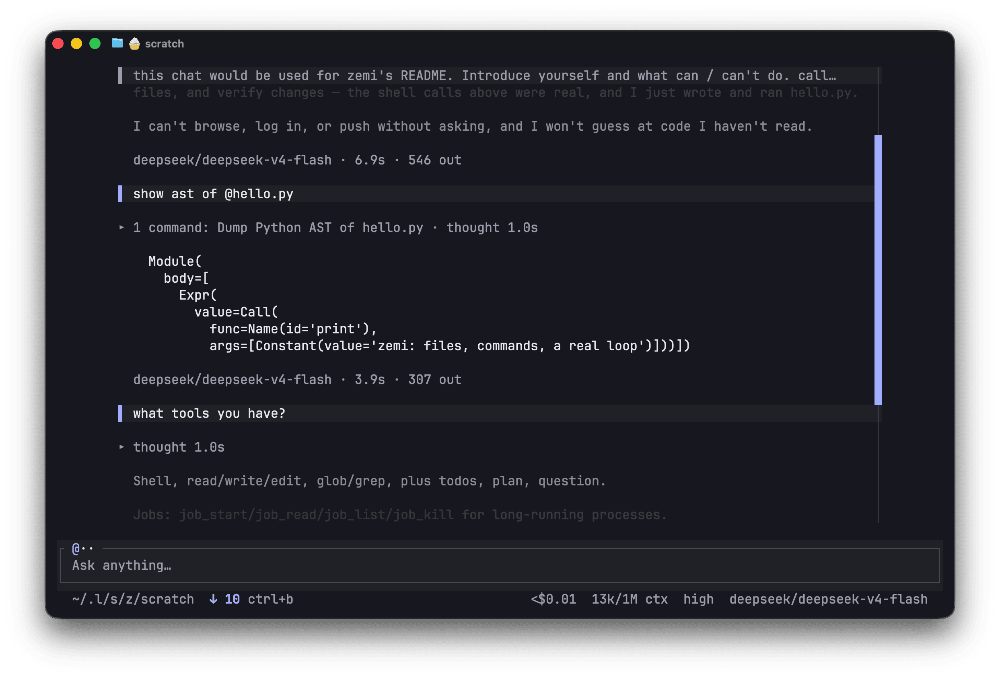

<div align="center">
	
	<h1>ZEMI 🐌</h1>
	<p>There are many agent harnesses,<br>but this one takes <i>the best from them</i></p>
</div>

<div align="center">
	
</div>

Zemi (/ˈzɛmi/) is a coding agent harness that...

- never forgets _anything_ with endless chats like [UniiChat](https://gist.github.com/VictorTaelin/91837951a5ce5b38f341ec1ba1df6449).
- fast and native like [crush](https://github.com/charmbracelet/crush)
- extensible and efficient like [pi](https://github.com/earendil-works/pi)
- batteries included like [codex](https://github.com/openai/codex) & [claude-code](https://github.com/anthropics/claude-code)
- has a nice TUI like [opencode](https://github.com/anomalyco/opencode)

...and can be whatever you want it to be.

> [!NOTE]
> I use zemi daily exclusively and have better experience with it than with other harnesses.
> However, things may be different for you. If you like this project but something is not working well, open an issue / PR.

Zemi is still iterating rapidly. There will be compatibility-breaking changes until it reaches v1.

## Install

```sh
go install github.com/metafates/zemi@latest
```

Then just run it. On first run it will prompt you to select inference provider and input api key (stored locally in OS keychain):

```sh
zemi
```

### "Make no mistakes" version

Or let your other agent install & set it up for you by pasting the following prompt in it:

```markdown
Install zemi with `go install github.com/metafates/zemi@latest`.
Then, follow `zemi docs setup` output - it guides you how to setup zemi.
```

<details>
<summary>In case you wonder what <code>zemi docs setup</code> outputs</summary>

```markdown
Set zemi up by following its documentation skill at `$path-to-zemi-documentation-skill`
(config.md in the same directory covers settings, providers and models, MCP, trust and the command line).

Ask the user how much of your own configuration to replicate: everything, only some parts, or a minimal setup.
Never write an API key into a file; config reads it with zemi.env.get("NAME").
```

</details>

## API keys

Zemi uses [`charmbracelet/catwalk`](https://github.com/charmbracelet/catwalk) for providers collection.
You can expect it to have most inference providers.

| Environment Variable        | Provider                                           |
| --------------------------- | -------------------------------------------------- |
| `ANTHROPIC_API_KEY`         | Anthropic                                          |
| `OPENAI_API_KEY`            | OpenAI                                             |
| `VERCEL_API_KEY`            | Vercel AI Gateway                                  |
| `GEMINI_API_KEY`            | Google Gemini                                      |
| `ZAI_API_KEY`               | Z.ai                                               |
| `MINIMAX_API_KEY`           | MiniMax                                            |
| `SYNTHETIC_API_KEY`         | Synthetic                                          |
| `HF_TOKEN`                  | Hugging Face Inference                             |
| `CEREBRAS_API_KEY`          | Cerebras                                           |
| `OPENROUTER_API_KEY`        | OpenRouter                                         |
| `IONET_API_KEY`             | io.net                                             |
| `ALIBABA_SINGAPORE_API_KEY` | Alibaba (Singapore)                                |
| `ALIBABA_US_API_KEY`        | Alibaba (United States)                            |
| `GROQ_API_KEY`              | Groq                                               |
| `AVIAN_API_KEY`             | Avian                                              |
| `OPENCODE_API_KEY`          | OpenCode Zen & Go                                  |
| `MOONSHOT_API_KEY`          | Moonshot                                           |
| `XAI_API_KEY`               | xAI                                                |
| `DEEPSEEK_API_KEY`          | DeepSeek                                           |
| `KIMI_CODING_API_KEY`       | Kimi Coding                                        |
| `AIHUBMIX_API_KEY`          | AIHubMix                                           |
| `ATLASCLOUD_API_KEY`        | Atlas Cloud                                        |
| `BASETEN_API_KEY`           | Baseten                                            |
| `CHUTES_API_KEY`            | Chutes                                             |
| `CORALBRICKS_API_KEY`       | CoralBricks                                        |
| `CORTECS_API_KEY`           | Cortecs                                            |
| `FIREWORKS_API_KEY`         | Fireworks                                          |
| `NEBIUS_API_KEY`            | Nebius Token Factory                               |
| `NEURALWATT_API_KEY`        | Neuralwatt                                         |
| `QINIUCLOUD_API_KEY`        | QiniuCloud                                         |
| `SCW_SECRET_KEY`            | Scaleway                                           |
| `VENICE_API_KEY`            | Venice AI                                          |
| `ZHIPU_API_KEY`             | Zhipu                                              |

## Local models, custom providers & configuration

Zemi uses [`charmbracelet/fantasy`](https://github.com/charmbracelet/fantasy) for communicating with providers and controlling agents.

You can ask your existing agent to setup zemi for you, including porting your local & custom providers. See [installation](#make-no-mistakes-version).

In case you need to do it yourself:

1. Open or create-if-not-exists `~/.config/zemi/init.lua` (zemi is configured through Lua)
2. Put this in your config:

```lua
zemi.provider.add({
	id = "my-local",
	kind = "openai_compat", -- or "anthropic", "openai" (OpenAI itself), "google", ...
	base_url = "http://localhost:11434/v1",
	-- api_key = zemi.env.get("MY_KEY"), -- for a server that wants one
	models = { { id = "qwen", context_window = 123000 } },
})
```

> [!NOTE]
> Zemi's Lua API is strictly typed, so you can expect to get type hints on hover in your IDE (ensure it supports Lua, e.g. install a plugin or setup a language server)

For further configuration just ask zemi itself.

## Plugins

Zemi supports claude-code plugins and marketplaces.
For example:

```sh
zemi plugin marketplace add anthropics/claude-plugins-official
zemi plugin add frontend-design@claude-plugins-official
```

It also has its own Lua-based plugins. Ask it to create something for itself:

```
/plugin new
```

## Feature scope or "why it doesn't support X or Y?"

Zemi is opinionated. It's not "one-size-fits-all", but that's why we have so many harnesses out there.
Each tool and feature zemi ships with is battle-tested.

For example, zemi...

- has plugins, but they can't change how zemi looks.
- doesn't have headless runs or GUI.
- doesn't have server-client architecture.
- doesn't have multiple sessions per project.

...but, it has todos, subagents, workflows, codemode, goals, plans.
